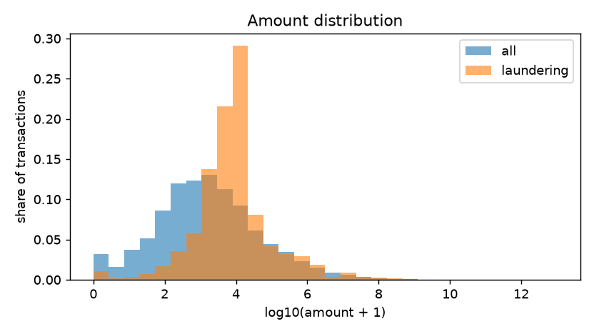
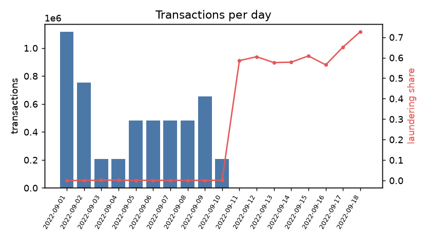
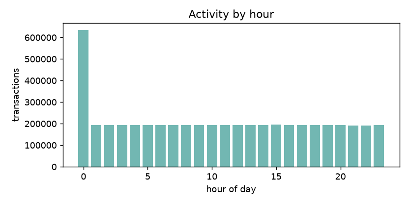
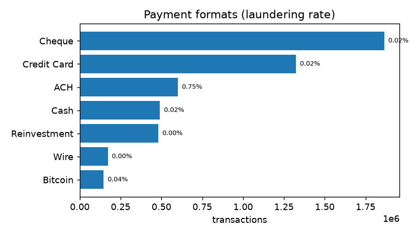
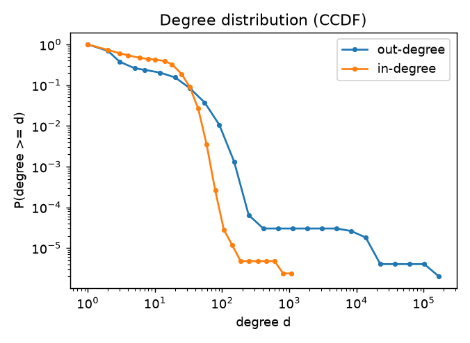
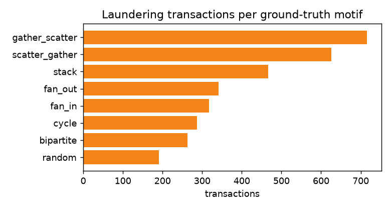

# Exploratory data analysis — HI-Small_Trans.csv

| statistic | value |
|---|---:|
| transactions | 5,078,345 |
| accounts | 515,088 |
| period | 2022-09-01 00:00:00 → 2022-09-18 16:18:00 |
| currencies | 15 |
| labelled transactions | 5,078,345 |
| laundering transactions | 5,177 (0.1019%) |
| median / p99 amount | 1,414.54 / 13,524,530.71 |
| max in / out degree | 1,084 / 168,672 |
| reciprocal account pairs | 0.73% |
| cross-currency payments | 1.42% |

## Payment formats

| format | transactions | laundering rate |
|---|---:|---:|
| Cheque | 1,864,331 | 0.017% |
| Credit Card | 1,323,324 | 0.016% |
| ACH | 600,797 | 0.746% |
| Cash | 490,891 | 0.022% |
| Reinvestment | 481,056 | 0.000% |
| Wire | 171,855 | 0.000% |
| Bitcoin | 146,091 | 0.038% |

## Ground-truth motifs

| motif | transactions |
|---|---:|
| gather_scatter | 716 |
| scatter_gather | 626 |
| stack | 466 |
| fan_out | 342 |
| fan_in | 318 |
| cycle | 287 |
| bipartite | 263 |
| random | 191 |

## Figures

