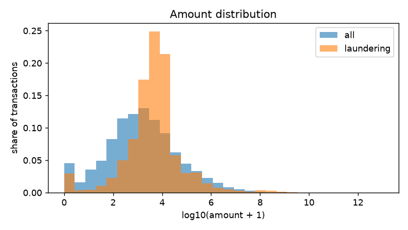
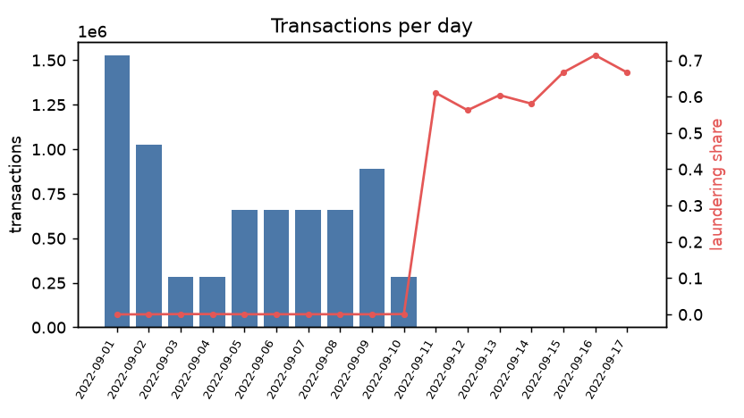
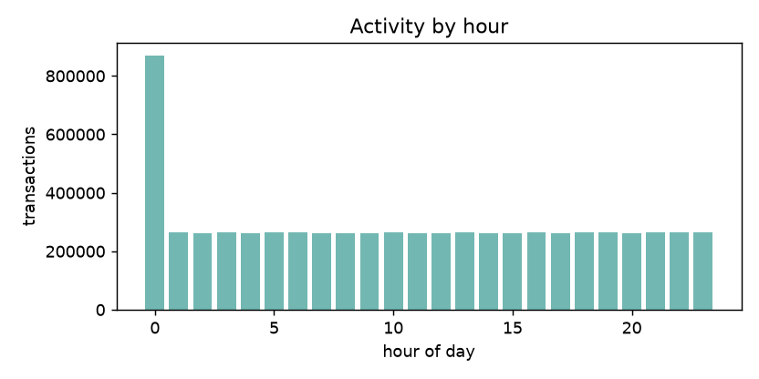
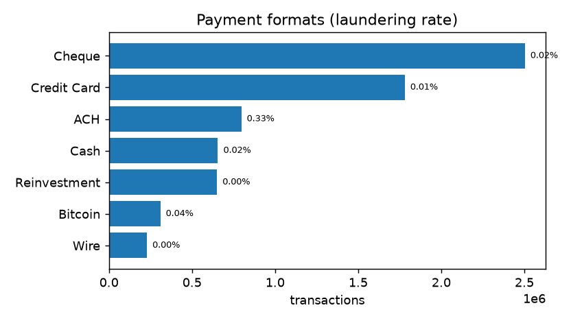
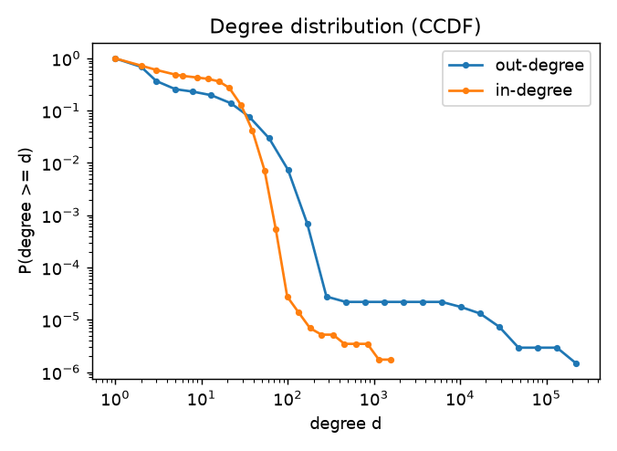
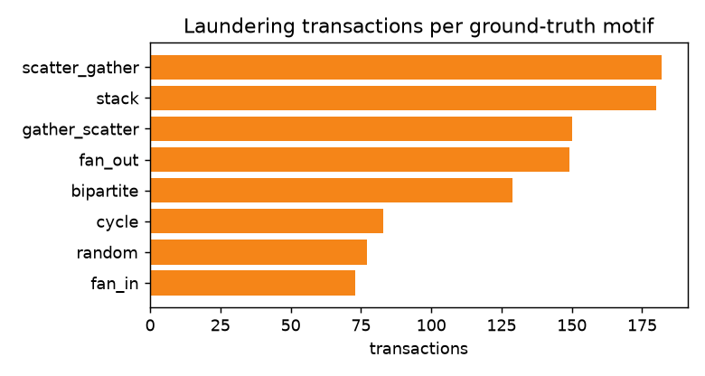

# Exploratory data analysis — LI-Small_Trans.csv

| statistic | value |
|---|---:|
| transactions | 6,924,049 |
| accounts | 705,907 |
| period | 2022-09-01 00:00:00 → 2022-09-17 15:28:00 |
| currencies | 15 |
| labelled transactions | 6,924,049 |
| laundering transactions | 3,565 (0.0515%) |
| median / p99 amount | 1,399.44 / 12,364,829.02 |
| max in / out degree | 1,553 / 222,037 |
| reciprocal account pairs | 0.70% |
| cross-currency payments | 1.43% |

## Payment formats

| format | transactions | laundering rate |
|---|---:|---:|
| Cheque | 2,503,158 | 0.018% |
| Credit Card | 1,780,389 | 0.015% |
| ACH | 796,581 | 0.328% |
| Cash | 655,688 | 0.019% |
| Reinvestment | 650,458 | 0.000% |
| Bitcoin | 309,208 | 0.036% |
| Wire | 228,567 | 0.000% |

## Ground-truth motifs

| motif | transactions |
|---|---:|
| scatter_gather | 182 |
| stack | 180 |
| gather_scatter | 150 |
| fan_out | 149 |
| bipartite | 129 |
| cycle | 83 |
| random | 77 |
| fan_in | 73 |

## Figures

